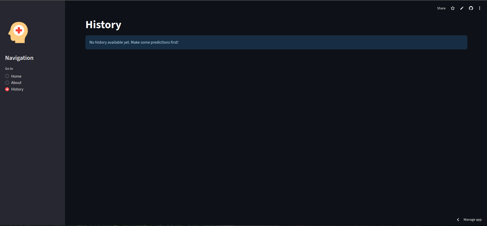

# Stress Level Detection System 🧠

## Description

The Stress Level Detection System is a machine learning-powered web application that helps users monitor and analyze their stress levels. Built with FastAPI, Streamlit, and scikit-learn, this system provides real-time stress level predictions based on various psychological and physiological factors.


### Features

- 🎯 Real-time stress level prediction
- 📊 Interactive visualization of results
- 💾 Session-based history tracking
- 🎨 User-friendly interface
- 🔄 API integration
- 🐳 Docker support

## Technology Stack

- **Backend**: FastAPI
- **Frontend**: Streamlit
- **ML Model**: scikit-learn
- **Containerization**: Docker
- **Data Validation**: Pydantic

## Frontend Overview





## Installation

### Prerequisites

- Python 3.11+
- Docker (optional)
- Git

### Option 1: Local Installation

1. Clone the repository:
```bash
git clone https://github.com/aminul01-g/Stress-Level-Detection-System.git
cd stress-level-detection
```

2. Create a virtual environment:
```bash
python -m venv .venv
source .venv/bin/activate  # On Windows: .venv\Scripts\activate
```

3. Install dependencies:
```bash
pip install -r requirements.txt
```

### Option 2: Docker Installation

1. Build the Docker image:
```bash
docker build -t stress-level-detaction-system .
```

2. Run the container:
```bash
docker run -d -p 8000:8000 --name stress-api stress-level-detaction-system
```

## Usage

### Running the Application

1. Start the FastAPI backend:
```bash
uvicorn app:app --reload --port 8000
```

2. Start the Streamlit frontend:
```bash
streamlit run frontend.py
```

3. Access the applications:
   - Frontend: http://localhost:8501
   - API Documentation: http://localhost:8000/docs

### API Endpoints

- `GET /`: API health check
- `POST /predict`: Get stress level prediction

Example API request:
```json
{
  "anxiety_level": 14,
  "mental_health_history": 0,
  "depression": 11,
  "headache": 2,
  "blood_pressure": 1,
  "breathing_problem": 4,
  "noise_level": 2,
  "study_load": 2,
  "future_career_concerns": 3,
  "peer_pressure": 3,
  "extracurricular_activities": 3,
  "bullying": 2,
  "social_support": 2
}
```

### Frontend Features

1. **Input Parameters**:
   - Anxiety Level (0-21)
   - Depression Score (0-27)
   - Mental Health History (Yes/No)
   - Physical Symptoms (headache, blood pressure, breathing)
   - Environmental Factors (noise, study load)
   - Social Factors (peer pressure, bullying, social support)

2. **Results**:
   - Stress Level Category
   - Probability Distribution
   - Personalized Recommendations

## Project Structure

```
stress-level-detection/
├── app.py                 # FastAPI application
├── frontend.py           # Streamlit frontend
├── Dockerfile           # Docker configuration
├── requirements.txt     # Python dependencies
├── Model/
│   ├── best_model.pkl   # Trained ML model
│   └── predict.py       # Prediction logic
└── schema/
    └── UserInput.py     # Data validation schemas
```

## Contributing

We welcome contributions to the Stress Level Detection System! Here's how you can help:

1. Fork the repository
2. Create a feature branch (`git checkout -b feature/AmazingFeature`)
3. Commit your changes (`git commit -m 'Add some AmazingFeature'`)
4. Push to the branch (`git push origin feature/AmazingFeature`)
5. Open a Pull Request

Please make sure to update tests as appropriate and adhere to the existing coding style.

## License

This project is licensed under the MIT License - see the [LICENSE](LICENSE) file for details.

## Acknowledgments

- Icons by [Icons8](https://icons8.com)
- Dataset used for training: StressLevelDataset
- Contributors and maintainers

---

For more information or support, please open an issue in the repository.
=======
# Stress-Level-Detection-System
The Stress Level Detection System is a machine learning-powered web application that helps users monitor and analyze their stress levels.

